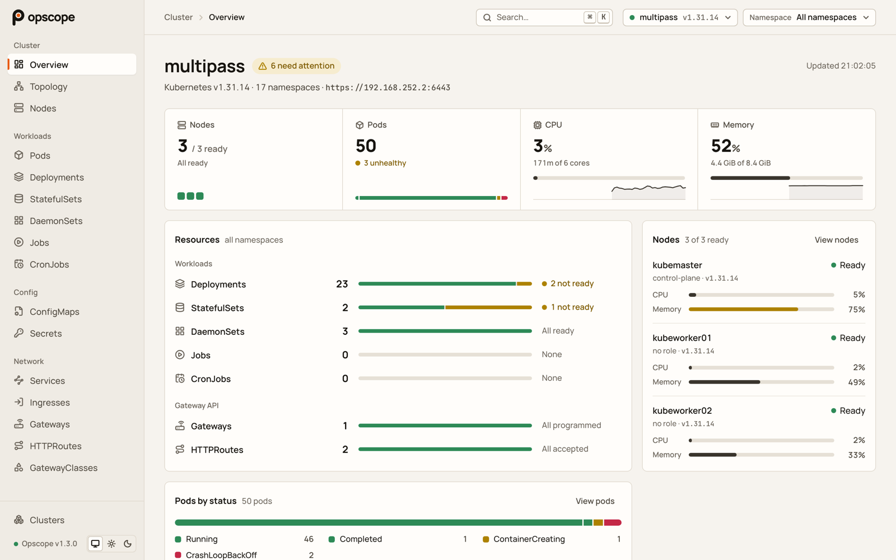
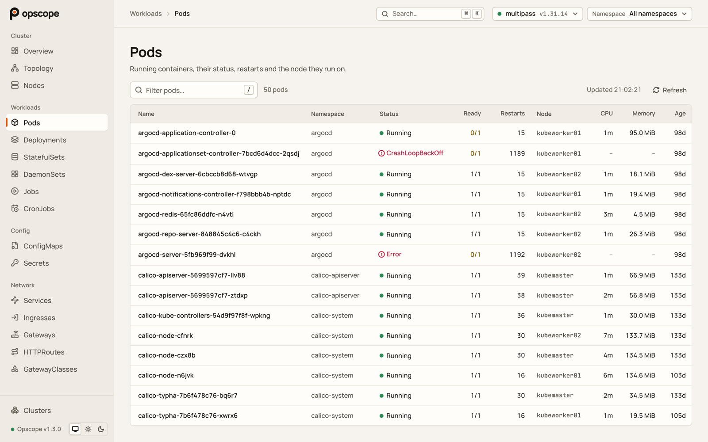
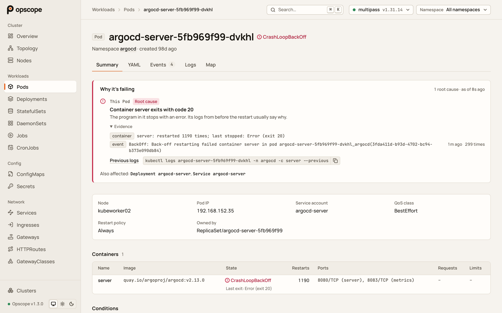
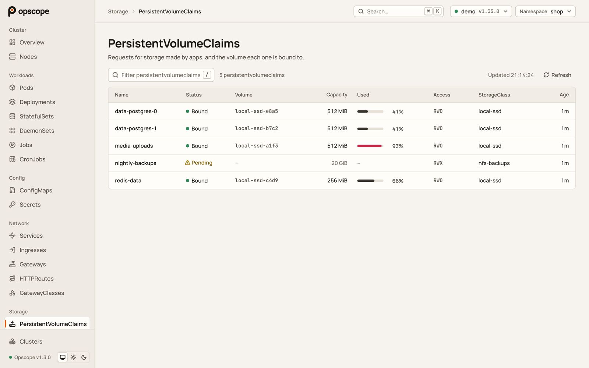
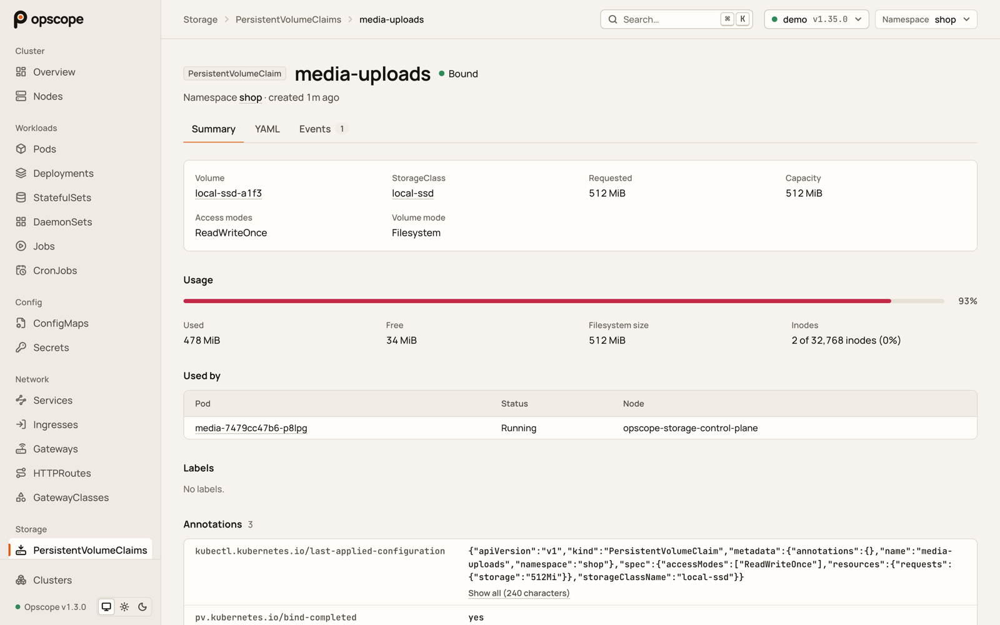

# Opscope

A lightweight, read-only Kubernetes dashboard for day-to-day operations.

[](https://github.com/unnikrishnanNam/opscope/actions/workflows/ci.yml)
[](https://github.com/unnikrishnanNam/opscope/releases/latest)
[](https://github.com/unnikrishnanNam/opscope/pkgs/container/opscope)
[](LICENSE)

https://github.com/user-attachments/assets/68c13ac5-ac03-4cff-af9e-cf6c682194e9

*A 48-second tour of Opscope and its command palette.*

Opscope answers the everyday questions about a cluster in a browser: is anything unhealthy, why is
this pod restarting, what does this Service route to, what did that job log. It shows nodes,
workloads, configuration, networking, events, logs and live resource usage, across as many clusters
as you connect, and finds any of it from one search box.

It is read-only by design. Opscope uses only `get` and `list`, and nothing in it can change a
cluster, so it can be given to anyone who needs to look, such as developers, on-call engineers and
support, without granting write access. It ships as a single container image and runs on your own
machine or inside the cluster it shows.

## Features

- **Cluster overview:** a health summary, nodes and pods by status, CPU and memory usage, every
  resource kind with what needs attention, and recent warning events.
- **Resources:** Nodes; Pods, Deployments, StatefulSets, DaemonSets, Jobs and CronJobs;
  ConfigMaps and Secrets; Services, Ingresses, and Gateway API Gateways, HTTPRoutes and
  GatewayClasses; PersistentVolumeClaims, PersistentVolumes and StorageClasses. Tables filter, sort
  and refresh on their own, with kubectl-style statuses such as `CrashLoopBackOff` and `Init:1/2`.
- **Storage:** claims link to their volumes, StorageClasses and the pods that use them, pods and
  StatefulSets show their volumes and claims, and the overview counts claims that can't bind and
  volumes left behind. Optionally, how full each volume is
  ([volume usage](docs/deployment.md#volume-usage), off by default).
- **Detail pages:** a summary, containers, conditions, events and YAML for every object, links to
  owners and nodes, and pod logs with the previous run and live follow.
- **Live usage:** CPU and memory per node and pod from metrics-server, with the last 15 minutes as
  a trend.
- **Command palette:** press ⌘K (Ctrl+K) to jump to any page, object, namespace or cluster, and to
  run what the current page offers, such as copying a read-only kubectl command.
- **Keyboard shortcuts** for pages and tabs, listed in the app with `?`.
- **Multiple clusters:** connect clusters from kubeconfig files, the pod's service account, or the
  UI, and switch between them.
- **Light and dark themes**, small screens, and keyboard and screen reader support (WCAG 2.1 AA).

## Install

Pick the way that fits what you want to do:

| You want to…                                               | Start here                                        |
| ---------------------------------------------------------- | ------------------------------------------------- |
| Try Opscope on your machine, with clusters you already use | [Try it on your machine](#try-it-on-your-machine) |
| Run Opscope in a cluster for your team                     | [Run it for your team](#run-it-for-your-team)     |
| Work on Opscope's code                                     | [Work on the code](#work-on-the-code)             |

### Try it on your machine

With Docker:

```bash
docker run --rm -p 127.0.0.1:8080:8080 -v opscope-data:/data ghcr.io/unnikrishnannam/opscope:latest
```

Open http://localhost:8080 and add a cluster by pasting or uploading a kubeconfig.
[Running Opscope on your machine](docs/local.md) covers starting with a kubeconfig file, kind
clusters, and cleaning up.

### Run it for your team

In the cluster Opscope should show:

```bash
kubectl apply -f https://raw.githubusercontent.com/unnikrishnanNam/opscope/v1.2.0/deploy/kubernetes/opscope.yaml
```

```bash
kubectl -n opscope port-forward svc/opscope 8080:80
```

Open http://localhost:8080. Before others use it, read [Deploying Opscope](docs/deployment.md): it
covers the optional Secret and volume usage roles, giving people access safely, keeping clusters
added in the UI, running with Docker on a server, upgrading and uninstalling.

### Work on the code

With Go and Node.js, run the backend and the frontend in two terminals:

```bash
make dev-backend
```

```bash
make dev-frontend
```

Open http://localhost:5173. [CONTRIBUTING.md](CONTRIBUTING.md#development-setup) covers the setup,
test clusters, building the image, and how changes are checked.

### Connecting clusters

Opscope has no built-in cluster and never reads `~/.kube/config` on its own. It gets clusters in
three ways: added in the UI (*Clusters → Add a cluster*), from a kubeconfig file given at startup
(`OPSCOPE_KUBECONFIG`), or from the pod's service account when it runs in a cluster. It can show
only what that user or service account is allowed to read. Every setting is listed under
[Configuration](docs/deployment.md#configuration).

## Command palette and shortcuts

Press ⌘K (Ctrl+K on Windows and Linux), or the search box in the top bar, and type:

- a page: "pods", or kubectl's short names such as `po`, `svc` and `cm`
- an object's name, of any kind ("argocd-server"); start with a kind to search only that kind
  (`po api`, `gtw main`). Objects in the selected namespace come first
- a namespace, another cluster ("switch to"), or the theme
- what the current page offers: open a tab, copy the name, the YAML or a kubectl command (`get`,
  `describe`, `logs`; read-only commands only), follow logs, go to the owner or the node

Enter runs the highlighted command, ⌘/Ctrl+Enter opens a link in a new tab, and Escape clears the
search, then closes the palette. Recently used commands come first when nothing is typed.

| Keys                         | Action                                                |
| ---------------------------- | ----------------------------------------------------- |
| `g` then `o` `n` `p` `d` `s` | Overview, Nodes, Pods, Deployments, Services          |
| `g` then `c`                 | Manage clusters                                       |
| `1` `2` `3` `4`              | An object's Summary, YAML, Events and Logs tabs       |
| `/`                          | Filter the current list                               |
| `?`                          | Every shortcut available on the current page          |

Shortcuts are ignored while you type in a field.

## Security

- **Read-only access.** Opscope uses only `get` and `list`, and the Kubernetes manifests grant
  nothing more. See [Permissions](docs/deployment.md#permissions).
- **No login.** Anyone who can open Opscope can read everything it can read. Keep it on
  `127.0.0.1`, reach it through `kubectl port-forward` in a cluster, or put an authenticating proxy
  in front of it. See [Giving people access](docs/deployment.md#giving-people-access).
- **Secrets** are listed by key name only. A value is fetched only when you choose "Reveal" on one
  key, is never cached, and never appears in the YAML view. Reading Secrets in a cluster needs a
  separate, optional role.
- **Volume usage** is off by default. It needs `get` on `nodes/proxy`, which reaches the kubelet's
  whole API, so it's turned on deliberately, with a setting and a separate, optional role. See
  [Volume usage](docs/deployment.md#volume-usage).
- **Logs** are never cached, since they can contain sensitive data.
- **Kubeconfigs added in the UI** are checked before they're accepted (no login commands or file
  paths, which could run programs or read files on the server), and saved with only the chosen
  context, readable only by Opscope.

## Screenshots

<picture>
  <source media="(prefers-color-scheme: dark)" srcset="docs/screenshots/overview-dark.png">
  
</picture>

| Pods | A pod's detail page |
| --- | --- |
| <picture><source media="(prefers-color-scheme: dark)" srcset="docs/screenshots/pods-dark.png"></picture> | <picture><source media="(prefers-color-scheme: dark)" srcset="docs/screenshots/pod-dark.png"></picture> |
| **PersistentVolumeClaims** | **A claim's detail page** |
| <picture><source media="(prefers-color-scheme: dark)" srcset="docs/screenshots/claims-dark.png"></picture> | <picture><source media="(prefers-color-scheme: dark)" srcset="docs/screenshots/claim-dark.png"></picture> |

## Documentation

| Document                                     | Contents                                                              |
| -------------------------------------------- | --------------------------------------------------------------------- |
| [Running Opscope on your machine](docs/local.md) | Trying Opscope with Docker: adding clusters, kubeconfig files, kind |
| [Deploying Opscope](docs/deployment.md)      | Running it for a team: installing, permissions, access, configuration, upgrading, uninstalling |
| [HTTP API](docs/api.md)                      | The JSON API behind the UI                                            |
| [Contributing](CONTRIBUTING.md)              | Development setup, project layout, tests, code style, releases       |
| [Design records](docs/design/)               | How and why Opscope was built, feature by feature                    |
| [Releases](https://github.com/unnikrishnanNam/opscope/releases) | What changed in each version                       |

## Roadmap

Planned and proposed work is tracked as
[enhancement issues](https://github.com/unnikrishnanNam/opscope/issues?q=is%3Aissue+is%3Aopen+label%3Aenhancement).
Suggestions are welcome; open a feature request.

## Contributing

Bug reports, feature requests and pull requests are welcome. [CONTRIBUTING.md](CONTRIBUTING.md)
explains the principles every change keeps, how to run Opscope from source, and how changes are
checked.

## License

Opscope is licensed under the [Apache License 2.0](LICENSE).

It bundles these third-party assets, under their own licences:

| Asset                                                  | Licence                                                    |
| ------------------------------------------------------ | ---------------------------------------------------------- |
| [Lucide](https://lucide.dev) icons (a subset)          | ISC, © Lucide Icons and Contributors                       |
| [Manrope](https://github.com/sharanda/manrope)         | SIL Open Font License 1.1, © The Manrope Project Authors   |
| [JetBrains Mono](https://github.com/JetBrains/JetBrainsMono) | SIL Open Font License 1.1, © The JetBrains Mono Project Authors |
